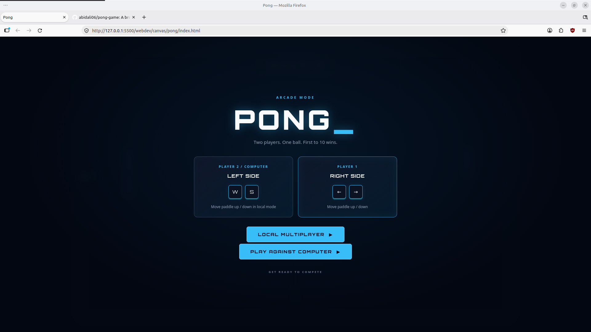
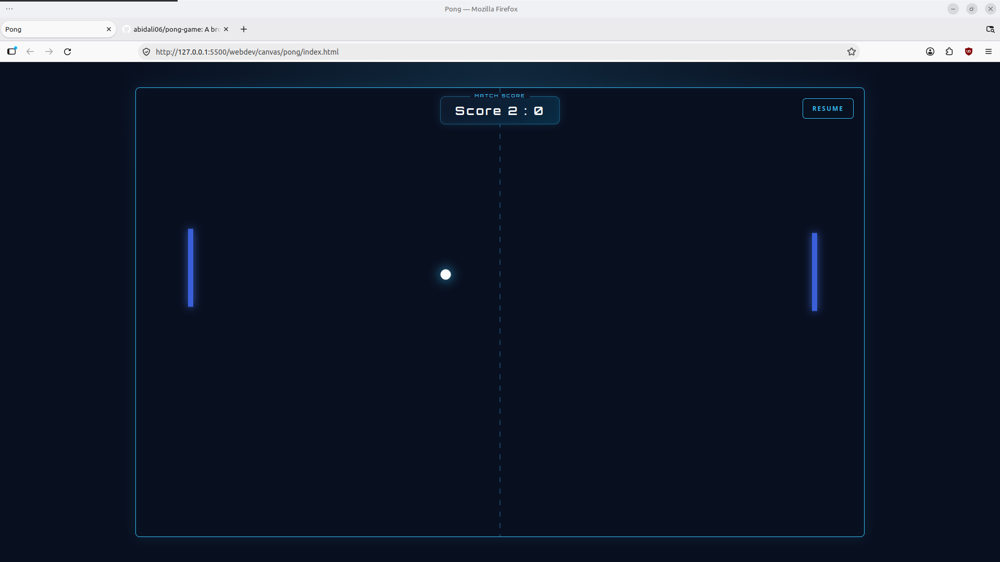
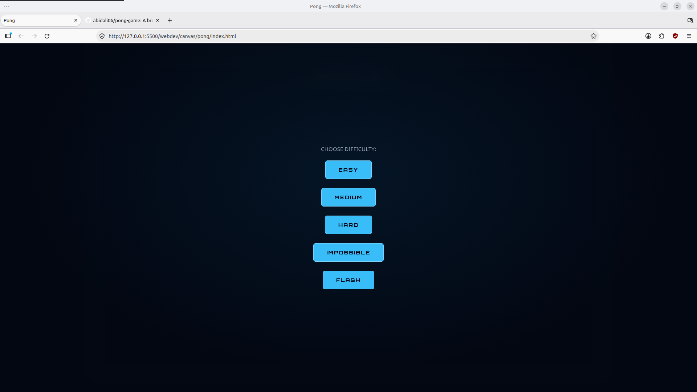

# Pong Game

A browser-based recreation of the classic Pong arcade game, built using vanilla JavaScript and HTML Canvas.

## Live Demo

[Play Pong](https://abidali06.github.io/pong-game/)

## Screenshots

### Main Menu


### Gameplay


### Difficulty Selection


## Features

- **Two game modes:** Play against an AI opponent or challenge another player locally.
- **Multiple AI difficulties:** Choose from Easy, Medium, Hard, Impossible, and Flash.
- **Physics-based ball movement:** Collision detection, angle-based rebounds, and progressive ball speed.
- **Responsive controls:** Keyboard controls for desktop and touch controls for mobile devices.
- **Game controls:** Pause, restart, and return to the main menu.
- **Procedural sound effects:** Audio generated using the Web Audio API.

## Controls

### Player 1
- `Arrow Right` / `Arrow Left` — Move paddle

### Player 2 (Local Multiplayer)
- `W` / `S` — Move paddle

### Mobile
- Drag your finger on the canvas to control your paddle.
- In local multiplayer, use the left and right halves of the screen to control the respective paddles.

## Technologies Used

- HTML5
- CSS3
- JavaScript (ES Modules)
- HTML Canvas API
- Web Audio API
- Pointer Events API

## How to Play

1. Open the game.
2. Choose Local Multiplayer or Play Against Computer.
3. If playing against the computer, select a difficulty.
4. First player to reach 10 points wins!

## Running Locally

Clone the repository:

```bash
git clone https://github.com/abidali06/pong-game.git
```

Open the project using a local development server. For example, use the Live Server extension in VS Code.

## License

This project is licensed under the MIT License.
